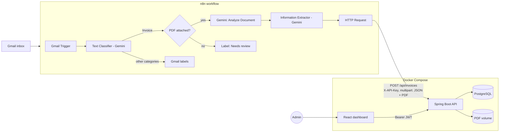
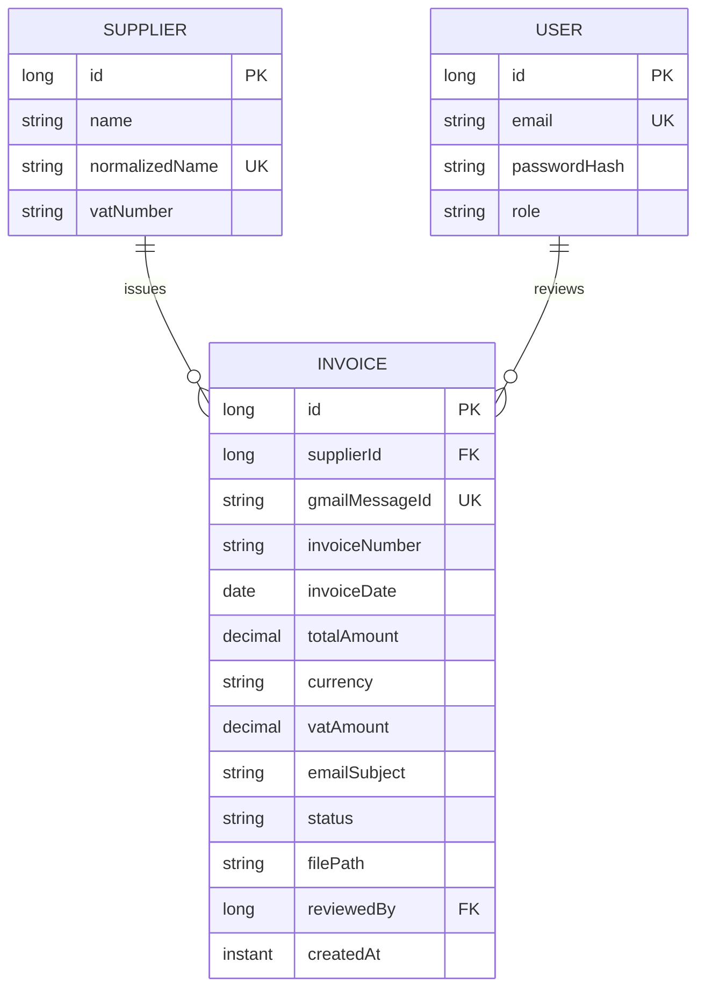
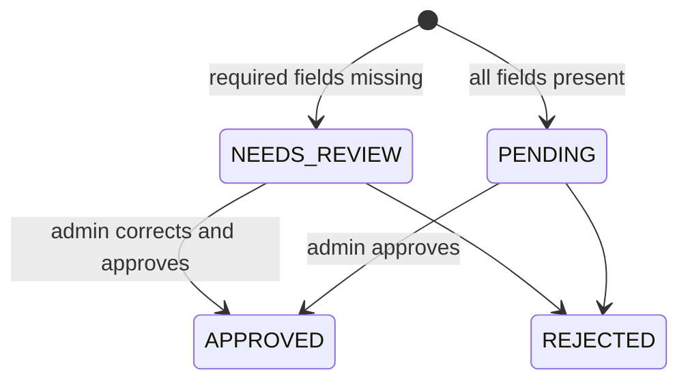

# Architecture

## Overview

Invoices arrive in Gmail. An n8n workflow classifies each email, extracts the invoice
data with Gemini, and sends it together with the original PDF to a Spring Boot API.
Admins review and analyze the invoices in a React dashboard.

## System diagram

## Components

| Component | Responsibility | Tech |
|-----------|---------------|------|
| n8n workflow | Classify emails, extract invoice fields, send to API | n8n, Gemini Flash |
| Backend API | Validate, store, serve data, authenticate | Spring Boot, Spring Security, JPA |
| Database | Invoices, suppliers, users | PostgreSQL (H2 in tests) |
| File storage | Original PDFs | Docker volume (`/data/invoices`) |
| Dashboard | Charts, table, review and correction | React |

## Authentication

| Client | Method | Access |
|--------|--------|--------|
| n8n | `X-API-Key` header | `POST /api/invoices` only (role `INGEST`) |
| Admin | Email + password, then JWT (Bearer) | Everything else (role `ADMIN`) |

The API key cannot read, edit or delete data. Secrets live in environment variables.

## Data model

Unique constraints: `gmailMessageId` (prevents duplicates when n8n retries) and
`(supplier, invoiceNumber)`.

## Review workflow

The backend sets the initial status. Stats only count `APPROVED` invoices.

## API

| Method | Path | Auth | Purpose |
|--------|------|------|---------|
| POST | `/api/invoices` | API key | Ingest invoice (multipart: `data` JSON + `file` PDF) |
| POST | `/api/auth/login` | none | Returns JWT |
| GET | `/api/invoices` | JWT | List, filter (date, supplier, status), paginate |
| GET | `/api/invoices/{id}` | JWT | Details |
| PATCH | `/api/invoices/{id}` | JWT | Correct values, change status |
| GET | `/api/invoices/{id}/file` | JWT | Download original PDF |
| GET | `/api/suppliers` | JWT | List suppliers |
| GET | `/api/stats` | JWT | Totals per supplier and per month |

Errors: `400` validation, `401` no credentials, `403` wrong role, `409` duplicate.

## Deployment (Docker Compose)

| Service | Image | Port | Notes |
|---------|-------|------|-------|
| `postgres` | postgres | 5432 | Volume for data |
| `backend` | Spring Boot | 8080 | Volume for PDFs, env: `N8N_API_KEY`, `JWT_SECRET`, DB credentials |
| `frontend` | React (nginx) | 3000 | Calls backend at `/api` |
| `n8n` (optional) | n8nio/n8n | 5678 | Same network, reaches backend at `http://backend:8080` |

## Key decisions

| Decision | Reason |
|----------|--------|
| Two auth methods | Machine and human clients have different needs and risks |
| `BigDecimal` for money | Avoids floating point errors |
| Gemini Flash | Cheap, fast, free tier, reads PDFs and scans |
| Review status | AI makes mistakes; humans approve before data counts |
| `gmailMessageId` unique | Idempotent ingestion |
| PDFs on a volume, path in DB | Simple; can move to S3/MinIO later |
| Supplier entity, no categories | Reliable per-supplier stats with less scope |
| H2 for tests, Postgres for runtime | Fast tests, realistic runtime |

## Out of scope

Line items, categories, multi-tenant users, notifications.